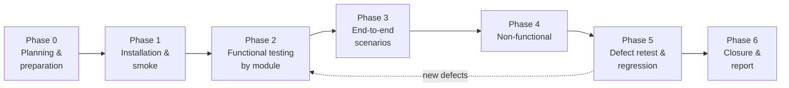

# Gym Tracker: System Test Plan

| Item | Value |
| --- | --- |
| System Under Test | Gym Tracker 1.0 (`frontend/` + `backend/`), running on `http://localhost:8080` |
| Test level | System testing: the complete, integrated application tested from the outside (browser and HTTP API), against the requirements |
| Basis | [requirements.md](requirements.md) (rule IDs AUTH, WKT, EXR, PRG, GOL, REQ, NFR) |
| Related | [test-plan.md](test-plan.md) (unit/integration design + automated results), [traceability-matrix.md](traceability-matrix.md) |
| Status of this plan | **Planned.** The "Actual result" and "Status" columns are left empty for the test team. Fill them only from a real execution. |

---

## 1. Purpose

Unit and integration tests (244 automated JUnit tests) prove that each rule works inside the code.
System testing answers a different question: **does the whole application, installed and started the way a user
starts it, do what the requirements say, through the real website?**

It also covers things the automated tests cannot see: what the user sees on screen, browser behaviour, restarting the
app, data surviving on disk, two users at once, and phone screens.

## 2. Scope

| In scope | Out of scope |
| --- | --- |
| All 10 pages of the website and their buttons ([BUTTON_GUIDE.md](../BUTTON_GUIDE.md)) | Load and stress testing (no performance requirement exists) |
| The REST API called directly (to test rules the browser normally stops) | Professional penetration testing |
| Installation and start-up (`./mvnw spring-boot:run`), restart, offline use | Hosted environments (the app is localhost only) |
| Persistence in `backend/data/gym-tracker.db` | Re-running the JUnit/JaCoCo/PIT suites (done in [test-plan.md](test-plan.md)) |
| Security basics: login, sessions, data isolation, HTML injection | Rules that need a different calendar day (e.g. a goal becoming OVERDUE), covered by unit tests |
| Usability basics: responsive layout, keyboard use, error messages | |
| Compatibility: Chrome, Firefox, Safari | |

## 3. Test approach

| Type of system test | How | Phase |
| --- | --- | --- |
| Installation / smoke | Start from a clean checkout, check the app and database come up | 1 |
| Functional (black-box) | One module at a time through the website; equivalence classes and boundary values from [test-plan.md §4](test-plan.md#4-black-box-test-design) | 2 |
| API-level negative tests | `curl` requests that skip the browser's own checks | 2, 4 |
| End-to-end scenarios | Realistic user journeys across modules | 3 |
| Security | Logged-out access, tokens, isolation between users, HTML injection | 4 |
| Persistence / recovery | Restart the server, check data; start with port 8080 busy | 4 |
| Usability and accessibility | Phone/tablet/desktop widths, keyboard only, clarity of messages | 4 |
| Compatibility | Repeat the smoke set in three browsers | 4 |
| Regression | Re-run the smoke set + failed cases after every fix | 5 |
| Exploratory | 30-minute time-boxed sessions per module with a charter | 2–3 |

Black-box techniques used for the cases below: **EP** equivalence partitioning, **BVA** boundary values,
**DT** decision tables, **ST** state transitions (workout PLANNED → IN_PROGRESS → COMPLETED, goal ACTIVE → ACHIEVED → COMPLETED),
**UC** use-case/scenario testing, **EG** error guessing.

## 4. Test environment

| Item | Setting |
| --- | --- |
| Machine | Any laptop with macOS, Windows or Linux |
| Java | JDK 17 or newer (`java -version`) |
| Start command | `cd backend && ./mvnw spring-boot:run` (Windows: `mvnw.cmd spring-boot:run`) |
| URL | `http://localhost:8080` |
| Browsers | Chrome, Firefox, Safari (latest versions); one is the "main" browser for phases 2–3 |
| Screen widths | 375 px (phone), 768 px (tablet), 1280 px (desktop), using the browser's device toolbar |
| Tools | Browser DevTools (Console, Network, Application → Local Storage), `curl`, optional `sqlite3` |
| Clean database | Stop the app, **move** `backend/data/gym-tracker.db` somewhere safe (to keep your own data), start again: a new empty database is created |

### Test data

| Data | Value |
| --- | --- |
| Tester accounts | `tester_a` / `tester.a@gym.test` / `lift4ever1`, and `tester_b` / `tester.b@gym.test` / `lift4ever2` |
| Plan (seeded) | Push Mon, Pull Tue, Legs Wed, rest Thu, Upper Fri, Lower Sat, rest Sun; 27 exercises, 37 entries |
| Dates | "today", "today − 1", "tomorrow": write the real dates in the execution log |

### Getting a token for API tests

```bash
curl -s -H 'Content-Type: application/json' -d '{"username":"tester_a","password":"lift4ever1"}' localhost:8080/api/auth/login
```

Copy the `token` value and use it as `-H 'Authorization: Bearer <token>'`. In the browser the same token is in
DevTools → Application → Local Storage → `gym-tracker-token`.

## 5. Phases



| Phase | Objective | Entry criteria | Main activities | Exit criteria | Deliverables | Suggested time |
| --- | --- | --- | --- | --- | --- | --- |
| **0 Planning & preparation** | Agree scope, roles, data and tools | Requirements baselined; build passes `./mvnw test` (244 tests) | Review this plan; assign cases; install browsers/tools; prepare accounts and dates; set up the defect log | Plan approved by the team; every case has an owner | This plan, filled execution log header, empty defect log | 1 day |
| **1 Installation & smoke** | Prove the build is testable at all | Phase 0 done | ST-01 … ST-06 | All smoke cases pass. **If one fails, stop and report: the build is rejected** | Smoke results | 0.5 day |
| **2 Functional by module** | Every functional requirement works through the website | Smoke passed | ST-10 … ST-66 per module (Auth → Workouts → Exercises → Progress → Goals), API negative cases, 1 exploratory session per module | All cases executed; every failure logged as a defect | Execution log, defect reports, session notes | 2–3 days |
| **3 End-to-end scenarios** | Modules work together in real user journeys | No open Critical defect in Phase 2 | SC-01 … SC-06 | All scenarios executed | Scenario results | 1 day |
| **4 Non-functional** | Security, persistence, usability, compatibility | Phase 3 executed | ST-70 … ST-86 | All cases executed | Results, screenshots for layout issues | 1 day |
| **5 Defect retest & regression** | Fixed defects are really fixed and nothing else broke | Fixes delivered (new build) | Retest each fixed defect; re-run the smoke set ST-01…ST-06, SC-01 and every case linked to the changed module; developers re-run `./mvnw test` | All fixed defects closed or reopened; regression set passes | Updated defect log, regression results | 1 day per fix round |
| **6 Closure** | Decide if the system is ready and record lessons | Exit criteria of §9 met, or the deadline reached | Collect metrics, write the summary report, archive logs and evidence | Report reviewed by the team | Test summary report (§12.3) | 0.5 day |

## 6. Roles

| Role | Responsibility |
| --- | --- |
| Test lead | Owns this plan, assigns cases, tracks progress daily, decides go/no-go with the team |
| Testers (team members) | Execute cases, record actual results and evidence, write defect reports, run exploratory sessions |
| Developer(s) | Fix defects, deliver a new build, run the automated suite before handing it over |
| Reviewer (instructor/peer) | Reviews the summary report |

Suggested split for a team of four: one module each in Phase 2 (Auth + Profile · Workouts · Exercises + Progress · Goals), then everyone takes scenarios and one non-functional area in Phases 3–4.

## 7. System test cases

How to read the tables: **Req** links to [requirements.md](requirements.md). "Expected result" is what the requirements
and the design say should happen. Error messages appear on the page with the rule code in brackets, e.g.
"… (WKT-01)". Fill **Actual** and **Status** (Pass / Fail / Blocked / Not run) during execution.

### 7.1 Phase 1: Installation and smoke

| ID | Req | Title | Steps | Expected result | Actual | Status |
| --- | --- | --- | --- | --- | --- | --- |
| ST-01 | NFR-01, NFR-03 | Clean start creates the database | 1. Stop the app, move `backend/data/gym-tracker.db` away. 2. `cd backend && ./mvnw spring-boot:run` | Log shows `Started GymTrackerApplication`; `backend/data/gym-tracker.db` exists again | | |
| ST-02 | NFR-01 | Home page loads | Open `http://localhost:8080` | Home page with "Push / Pull / Legs + Upper / Lower"; summary shows **37** total exercises, **5** training days, **2** recovery days; weekly flow shows Mon–Sun with Thu and Sun as "Rest / Mobility" | | |
| ST-03 | WKT-08 | Plan shown and filterable | On the home page click the filter "Pull Day", then "All" | Only the Pull Day card (7 exercises) is visible, then all 5 day cards | | |
| ST-04 | AUTH-01…05 | Register | Sign up as `tester_a` | Dashboard opens with "Hi, tester_a" | | |
| ST-05 | WKT-08, WKT-10 | Start and log one set | Plan → Start Push Day → Dumbbell Press 30 kg × 8 → Log set | Status "In progress", "1 completed sets", "240 kg" | | |
| ST-06 | WKT-04 | Complete | Complete workout → 45 → Complete | Status "Completed", "45 min", message "Workout completed. Nice work!" | | |

### 7.2 Phase 2: User management (AUTH)

| ID | Req | Technique | Steps | Expected result | Actual | Status |
| --- | --- | --- | --- | --- | --- | --- |
| ST-10 | AUTH-01 | BVA | Register with username `ab`, then `abc`, then 31 characters, then 30 characters (fresh names) | `ab` and 31 chars: "Username must be 3–30 characters using only letters, digits or underscore (AUTH-01)". `abc` and 30 chars: account created | | |
| ST-11 | AUTH-01 | EP | Register with username `tester-c` and `tester c` | Same AUTH-01 message for both | | |
| ST-12 | AUTH-02 | EP | Register with email `gym.test`, then `a@b` | "Enter a valid email address (max 100 characters) (AUTH-02)" | | |
| ST-13 | AUTH-03 | BVA | Password `abcdef1` (7), then `abcdefg1` (8) | 7: "Password must be 8–64 characters long (AUTH-03)"; 8: accepted | | |
| ST-14 | AUTH-03 | DT | Passwords `abcdefgh`, `12345678`, `abcdefg!` | All three: "Password must contain at least one letter and one digit (AUTH-03)" | | |
| ST-15 | AUTH-04 | EG | Register `TESTER_A` (other email), then a new name with `TESTER.A@gym.test` | "That username is already taken (AUTH-04)", then "That email is already registered (AUTH-04)" | | |
| ST-16 | AUTH-06 | DT | Log in with wrong password; with unknown username; with empty fields | Wrong/unknown: "Wrong username or password (AUTH-06)" (same text for both). Empty: "Enter your username and password (AUTH-06)" | | |
| ST-17 | AUTH-08 | EG | Logged out, type `localhost:8080/dashboard.html` and `/workouts.html` in the address bar | Redirected to the login page each time | | |
| ST-18 | AUTH-07 | ST | Log in, click Log out, then press the browser Back button | Home page with Log in / Sign up; going back to a private page redirects to login | | |
| ST-19 | AUTH-09 | BVA | Profile: display name 50 characters, then 51 (via DevTools remove `maxlength`, or API) | 50: "Profile saved" and dashboard greets the new name. 51: "Display name must be at most 50 characters (AUTH-09)" | | |
| ST-20 | AUTH-04, AUTH-02 | EG | Profile: change email to `tester.b@gym.test` (after tester_b exists) | "That email is already registered (AUTH-04)"; email unchanged after reload | | |
| ST-21 | AUTH-10 | DT | Change password with wrong current password; then correct current + `newpass99`; log out; log in with old, then new password | Wrong: "Current password is incorrect (AUTH-10)". Correct: "Password changed". Old password fails (AUTH-06), new works | | |

### 7.3 Phase 2: Workout management (WKT)

| ID | Req | Technique | Steps | Expected result | Actual | Status |
| --- | --- | --- | --- | --- | --- | --- |
| ST-30 | WKT-08 | EP | Workouts → New workout with each plan day, and once with "Custom (empty)" | Each plan day opens with its exercises (Push 7, Pull 7, Legs 7, Upper 9, Lower 7) and target sets × reps; Custom opens empty with name "Custom workout"; all start as "Planned" | | |
| ST-31 | WKT-01 | BVA | Log sets with reps 0, 1, 100, 101 (weight 20) | 0 and 101: "Repetitions must be a whole number from 1 to 100 (WKT-01)", nothing added. 1 and 100: set added | | |
| ST-32 | WKT-02 | BVA | Log sets with weight −0.25, 0, 500, 500.25 (reps 5) | −0.25 and 500.25: "Weight must be from 0 to 500 kg (WKT-02)". 0 and 500: set added | | |
| ST-33 | WKT-01, REQ-01 | EG | Log a set with reps 5.5 | "Request body is missing, malformed or has a wrong value type (REQ-01)" (reps must be a whole number); no set added | | |
| ST-34 | WKT-03 | BVA | Log 20 sets on one exercise, then a 21st | The 20th is accepted; the 21st: "An exercise can have at most 20 sets (WKT-03)" | | |
| ST-35 | WKT-03 | BVA | Add exercise with target sets 0, 1, 20, 21 | 0 and 21: "Number of sets must be from 1 to 20 (WKT-03)". 1 and 20: exercise added | | |
| ST-36 | WKT-10 | ST | Planned workout: press Start; check the button; reload | Status "In progress"; Start button gone | | |
| ST-37 | WKT-10 | ST | Planned workout: log a set without pressing Start | Status changes to "In progress" by itself | | |
| ST-38 | WKT-05 | DT | Planned workout, no sets: Complete workout → 30 → Complete | Dialog shows "Log at least one completed set before finishing the workout (WKT-05)"; still not completed | | |
| ST-39 | WKT-05 | DT | Log one set, untick "done", then Complete with 30 | Same WKT-05 message (an un-ticked set does not count) | | |
| ST-40 | WKT-04 | BVA | Workout with a ticked set: Complete with 0, 301, then 300 | 0 and 301: "Workout duration must be from 1 to 300 minutes (WKT-04)". 300: completed, "300 min" shown | | |
| ST-41 | WKT-07 | DT | Started workout with a set: open Complete, clear the field, Complete | Completed; duration = minutes since start (at least 1) | | |
| ST-42 | WKT-06 | ST, API | Completed workout: `curl -X POST …/api/workouts/{id}/complete` with token and `{"durationMinutes":30}` | HTTP 400 `{"code":"WKT-06","message":"This workout is already completed"}`; in the UI the Complete button is hidden | | |
| ST-43 | WKT-09 | BVA | New workout dated **tomorrow**, log a set, Complete with 30 | "A workout dated in the future cannot be completed (WKT-09)" | | |
| ST-44 | WKT-09 | BVA | Completed workout → Edit → date tomorrow → Save; then date yesterday → Save | Tomorrow: "A completed workout cannot be dated in the future (WKT-09)". Yesterday: saved | | |
| ST-45 | WKT-11 | UC | Edit name, notes and duration of a completed workout | New values shown after Save and after reload | | |
| ST-46 | WKT-11 | UC | Edit a set's weight and reps in place | Totals (sets, volume) update; values stay after reload | | |
| ST-47 | WKT-12 | DT | Completed workout with exactly one ticked set: untick it; then press ✕ on it | Red message "A completed workout must keep at least one completed set (WKT-12)"; tick comes back; set not deleted | | |
| ST-48 | WKT-12 | DT | Completed workout with two ticked sets on different exercises: untick one; remove the other exercise | First action allowed; the second is refused with WKT-12 | | |
| ST-49 | WKT-11 | UC | Delete a workout: press Delete, choose Cancel; press Delete, choose OK | Cancel: nothing changes. OK: back on Workouts, the workout is gone from History; Progress totals drop accordingly | | |
| ST-50 | PRG-06 | EP | Workouts → filters All / Planned / In progress / Completed | Each filter shows only that status; the active filter is highlighted; newest first | | |

### 7.4 Phase 2: Exercise management (EXR)

| ID | Req | Technique | Steps | Expected result | Actual | Status |
| --- | --- | --- | --- | --- | --- | --- |
| ST-55 | EXR-01 | EP | Open Exercises | "27 found" | | |
| ST-56 | EXR-02 | EP | Search `curl`; then `CURL`; then `  row  `; then `lower` | `curl`/`CURL`: 5 (4 biceps curls + Leg Curls). `row`: 3. `lower`: Back Extension (matched by its description "Lower back") | | |
| ST-57 | EXR-03 | EP | Search `curl` + muscle group Biceps; then search empty + Core | 4; then 3 (High-Low Plank, Hanging Leg Raises, Kneeling Twists) | | |
| ST-58 | EXR-04…07 | BVA/EP | Create custom: name `X`; name `Zottman Curl` without muscle group; `Zottman Curl` + Biceps; `squats` + Quads | `X`: "Exercise name must be 2–50 characters (EXR-04)". No group: "Choose a muscle group (EXR-05)". Zottman: added with a "Custom" badge. `squats`: 'An exercise called "squats" already exists (EXR-06)' | | |
| ST-59 | EXR-01 | UC | Open any workout → Add exercise list | "Zottman Curl · Biceps (custom)" is in the list and can be added | | |

### 7.5 Phase 2: Progress tracking (PRG)

Use a **fresh account** so the expected numbers can be calculated by hand.

| ID | Req | Technique | Steps | Expected result | Actual | Status |
| --- | --- | --- | --- | --- | --- | --- |
| ST-60 | PRG-01…04 | EP | New account → Progress | All totals 0; 8 weekly bars, all empty; "0 of 5 training days" | | |
| ST-61 | PRG-01, 02, 07 | DT | Complete Push dated **today − 1** (Dumbbell Press 40 × 10) and Pull dated **today** (Lat Pulldown 50 × 10); leave a Legs workout In progress with Squats 100 × 5 | Completed workouts **2**; volume **900**; the in-progress 500 is **not** counted | | |
| ST-62 | PRG-03 | BVA | Same data as ST-61 | Current streak **2**, longest streak **2** | | |
| ST-63 | PRG-04 | EP | Same data | This week's count includes today's workout, plus yesterday's if yesterday is in the same Mon–Sun week; percent = count × 100 ÷ 5, rounded down; the last bar is this week | | |
| ST-64 | PRG-04 | BVA | Add and complete a workout dated **8 days ago** | It shows in an earlier week's bar, not in this week's tracker | | |
| ST-65 | PRG-05 | UC | Progress → Exercise = Dumbbell Press (or Exercises → View progress) | Line chart and table with one row: heaviest set 40 kg, 1 set, volume 400 kg | | |
| ST-66 | PRG-06 | UC | Progress → History | Only completed workouts, newest first, with sets, volume and minutes | | |

### 7.6 Phase 2: Goal management (GOL)

| ID | Req | Technique | Steps | Expected result | Actual | Status |
| --- | --- | --- | --- | --- | --- | --- |
| ST-67 | GOL-03 | BVA | New goal with target date yesterday (type it in), then today | Yesterday: "Target date cannot be in the past (GOL-03)". Today: created | | |
| ST-68 | GOL-02, 05 | BVA | Workout-count goal with target 0, then 2.5, then 2 | 0: "Target value must be greater than 0 (GOL-02)". 2.5: "A workout-count target must be a whole number (GOL-05)". 2: created | | |
| ST-69 | GOL-04, 05 | BVA | Weight goal (Dumbbell Press) with target 500.5, then 500 | 500.5: "A weight target cannot be above 500 kg (GOL-05)". 500: created | | |
| ST-70 | GOL-06, 07, 10 | ST | Goal "2 workouts" created today. Complete 1 workout dated today, check; complete another, check | After 1: 50 %, state "Active", Mark completed disabled. After 2: 100 %, "Achieved", Mark completed enabled | | |
| ST-71 | GOL-08, 09 | ST | Press Mark completed | State "Completed", "done <date>"; Edit and Mark completed buttons disappear; Delete remains | | |
| ST-72 | GOL-06 | EG | Create a workout-count goal today, then complete a workout dated **yesterday** | Goal stays at 0 %: only workouts dated on/after the goal's start day count | | |
| ST-73 | GOL-03 | DT | Edit an active goal: change only the title; change the date to yesterday | Title change saved. Date change refused with GOL-03 | | |

## 8. End-to-end scenarios (Phase 3)

Write every observed value in the execution log; compare with the expected values.

| ID | Scenario | Steps | Expected result |
| --- | --- | --- | --- |
| **SC-01** | First week of a new member | 1. Register `sc01_user`. 2. Create goal "3 sessions" (WORKOUT_COUNT 3, date next month). 3. Create and complete Push dated today − 2 (Dumbbell Press 40 × 10, 45 min), Pull dated today − 1 (Lat Pulldown 50 × 10, 50 min), Legs dated today (Squats 60 × 10, 55 min). 4. Open Dashboard, Progress, Goals | Completed **3**, volume **1500**, current streak **3**. Weekly tracker counts the ones inside this Mon–Sun week. Goal shows **1 / 3 = 33 %** (only today's workout is on/after the goal's start date: rule GOL-06) |
| **SC-02** | Fixing mistakes | 1. Start Upper. 2. Log 300 kg × 8 by mistake, correct it to 30 kg in place. 3. Log a second set, untick it. 4. Delete the un-ticked set. 5. Complete (40 min). 6. Edit duration to 42. 7. Delete the workout | After step 2 volume = 240; after 4 one set left; completion works; duration 42 shown; after 7 the workout is gone from History and Progress totals are back to their earlier values |
| **SC-03** | Own routine | 1. Create custom exercise "Hip Thrust" (Glutes). 2. New workout "Custom (empty)", name "Glute day". 3. Add Hip Thrust (4 × 10) and Squats (3 × 8). 4. Log sets on both, complete. 5. Progress → Hip Thrust | The custom exercise appears in the Add list, the workout completes, and the progress chart for Hip Thrust shows today's heaviest set |
| **SC-04** | Two users on one computer | 1. Browser 1: `tester_a` logs a workout and a custom exercise. 2. Browser 2 (or private window): `tester_b` opens Workouts, Exercises, Goals. 3. `tester_b` types `workout.html?id=<A's id>` | B sees none of A's workouts, custom exercises or goals; step 3 shows "Workout not found (NOT-FOUND)" and no data |
| **SC-05** | Data survives a restart | 1. Note Dashboard numbers for `tester_a`. 2. Stop the server (Ctrl+C), start it again. 3. Log in | Same numbers, same history; you have to log in again only if you logged out (tokens are stored in the database) |
| **SC-06** | Password change with two sessions | 1. Log in as `tester_a` in browser 1 and browser 2. 2. Browser 1: change password. 3. Browser 2: open any page | Browser 1 stays logged in. Browser 2 is sent to the login page (other sessions are signed out: AUTH-10) |

## 9. Non-functional cases (Phase 4)

| ID | Req | Area | Steps | Expected result | Actual | Status |
| --- | --- | --- | --- | --- | --- | --- |
| ST-75 | AUTH-08 | Security | `curl -i localhost:8080/api/workouts` (no token) | HTTP 401, `{"code":"AUTH-08","message":"Please log in"}` | | |
| ST-76 | AUTH-08 | Security | DevTools → Local Storage: change `gym-tracker-token` to `abc`, reload Dashboard | Sent to the login page; the bad token is removed | | |
| ST-77 | AUTH-08 | Security | (needs `sqlite3`) Stop the app; `UPDATE auth_tokens SET created_at='2020-01-01T00:00';`; start; reload a page | Sent to login; the API answered "Your session expired, please log in again" (visible in DevTools → Network) | | |
| ST-78 | AUTH-05 | Security | (needs `sqlite3`) `SELECT username, password_hash FROM users;` | Hashes start with `$2`; no plain passwords anywhere | | |
| ST-79 | NFR-06 | Security | Workout name ``, exercise name `<b>bold</b>`, goal title `<script>alert(1)</script>` | Shown literally as text; no alert, no bold text | | |
| ST-80 | AUTH-11 | Security | With `tester_b`'s token: `curl -X DELETE …/api/workouts/<A's id>` | HTTP 404 `NOT-FOUND`; A's workout still exists | | |
| ST-81 | NFR-03 | Recovery | Start a second copy of the app while one is running | Second copy stops with "Port 8080 was already in use"; the first keeps working, no data lost | | |
| ST-82 | NFR-02 | Offline | Turn Wi-Fi off; restart the app; use every page | Everything works; only "Open Sheet" (Google) needs internet | | |
| ST-83 | NFR-05 | Usability | Every page at 375, 768 and 1280 px | No sideways scrolling; ☰ menu works below 1040 px; tables scroll inside their card; dialogs fit the screen | | |
| ST-84 | NFR-05 | Accessibility | Keyboard only (Tab, Shift+Tab, Enter, Space, Esc): register, start a workout, log a set, complete, close a dialog | Everything reachable; focus ring visible; Esc closes dialogs | | |
| ST-85 | NFR-05 | Usability | Trigger 5 different errors | Every message says what to fix, appears next to the form or as a red message, and shows the rule code | | |
| ST-86 | NFR-04 | Compatibility | Run ST-02…ST-06 and SC-01 in Chrome, Firefox and Safari | Same behaviour and layout in all three | | |

## 10. Entry, exit, suspension and resumption criteria

**Entry (to start system testing):** `./mvnw test` passes (244 tests); the app starts with `./mvnw spring-boot:run`;
this plan is approved; test accounts and tools are ready.

**Exit (system testing is complete):**
- 100 % of planned cases executed (or explicitly marked Not run with a reason).
- At least 95 % of executed cases passed.
- No open **Critical** or **Major** defects; every open Minor/Trivial defect is accepted and listed in the report.
- All six end-to-end scenarios passed.
- Every functional requirement has at least one executed system test (check against §13).

**Suspend testing** when: the smoke set fails, the app cannot start, data is lost or corrupted, or a Critical defect blocks more than 30 % of the remaining cases.
**Resume** when: a new build fixes the blocker and the smoke set passes again.

## 11. Defect management

### Severity

| Severity | Meaning | Example |
| --- | --- | --- |
| Critical | Data loss, security hole, or the app/page cannot be used at all | User B can delete user A's workout; the app does not start |
| Major | A requirement is not met and there is no reasonable workaround | Volume counts un-ticked sets; a valid 100-rep set is refused |
| Minor | Wrong behaviour with a workaround, or a misleading message | Error appears without its rule code; the filter highlight is wrong |
| Trivial | Cosmetic | Spacing, alignment, typo |

**Priority** (P1 fix now, P2 fix before the release, P3 fix if time allows) is set by the team, independently of severity.

### Lifecycle

New → Assigned → Fixed → Ready for retest → **Closed** (retest passed) or **Reopened** (retest failed → Assigned).
Rejected (not a defect / duplicate / works as specified) needs a short reason.

### Defect report template

```
ID:            DEF-001
Title:         (one line: what is wrong, where)
Test case:     ST-xx / SC-xx
Requirement:   e.g. WKT-01
Build/commit:  (git commit hash or date of the build)
Environment:   OS, browser + version, screen width
Severity / Priority:
Preconditions: (account, data)
Steps to reproduce:
  1.
  2.
Expected result:
Actual result:
Evidence:      screenshot / console / network response
Status:        New
Reported by / date:
```

## 12. Templates and metrics

### 12.1 Execution log (one row per run)

| Date | Tester | Build | Browser | Case | Actual result | Status | Defect | Evidence |
| --- | --- | --- | --- | --- | --- | --- | --- | --- |
| | | | | | | | | |

### 12.2 Metrics to report

| Metric | Formula |
| --- | --- |
| Execution progress | executed ÷ planned × 100 |
| Pass rate | passed ÷ executed × 100 |
| Requirement coverage | requirements with ≥ 1 passed system test ÷ all functional requirements × 100 |
| Defects by severity / module | count |
| Defect fix rate | closed ÷ reported × 100 |
| Retest failure rate | reopened ÷ retested × 100 |

### 12.3 Test summary report (Phase 6)

1. What was tested (build, dates, environment, who).
2. Results: planned / executed / passed / failed / blocked per phase and module.
3. Defects: totals by severity, open defects with justification.
4. Requirement coverage (§13) and anything not tested, with the reason.
5. Exit criteria: met or not, one line each.
6. Recommendation: ready / ready with known issues / not ready.
7. Lessons learned.

## 13. Requirement → system test coverage

| Requirement | System tests |
| --- | --- |
| AUTH-01 | ST-10, ST-11 |
| AUTH-02 | ST-12, ST-20 |
| AUTH-03 | ST-13, ST-14 |
| AUTH-04 | ST-15, ST-20 |
| AUTH-05 | ST-78 |
| AUTH-06 | ST-16, ST-21 |
| AUTH-07 | ST-18 |
| AUTH-08 | ST-17, ST-75, ST-76, ST-77 |
| AUTH-09 | ST-19 |
| AUTH-10 | ST-21, SC-06 |
| AUTH-11 | ST-80, SC-04 |
| WKT-01 | ST-31, ST-33 |
| WKT-02 | ST-32 |
| WKT-03 | ST-34, ST-35 |
| WKT-04 | ST-40, ST-45 |
| WKT-05 | ST-38, ST-39 |
| WKT-06 | ST-42 |
| WKT-07 | ST-41 (the "never started" branch cannot be reached in the UI, because logging a set starts the workout; it is covered by automated tests) |
| WKT-08 | ST-03, ST-30 |
| WKT-09 | ST-43, ST-44 |
| WKT-10 | ST-36, ST-37 |
| WKT-11 | ST-45, ST-46, ST-49, SC-02 |
| WKT-12 | ST-47, ST-48 |
| EXR-01 | ST-55, ST-59 |
| EXR-02 | ST-56 |
| EXR-03 | ST-57 |
| EXR-04 … EXR-07 | ST-58 |
| PRG-01 … PRG-03 | ST-60, ST-61, ST-62, SC-01 |
| PRG-04 | ST-63, ST-64 |
| PRG-05 | ST-65, SC-03 |
| PRG-06 | ST-50, ST-66 |
| PRG-07 | ST-61 |
| GOL-01 … GOL-05 | ST-67, ST-68, ST-69 |
| GOL-06, GOL-07 | ST-70, ST-72, SC-01 |
| GOL-08, GOL-09 | ST-71 |
| GOL-10 | ST-70, ST-71 (OVERDUE needs a past target date and is covered by unit tests) |
| NFR-01 … NFR-06 | ST-01, ST-02, ST-79, ST-81 … ST-86, SC-05 |

## 14. Risks

| Risk | Effect | Mitigation |
| --- | --- | --- |
| Testers use their personal database | Expected numbers don't match; personal data mixed with test data | Move `backend/data/gym-tracker.db` aside before Phase 1 (see §4) |
| Expected numbers depend on today's weekday | Weekly tracker values differ per day | Calculate them on the day and write the dates in the log (ST-63, SC-01) |
| An old server still running on port 8080 | New build doesn't start, or testers test the old build | Check the start-up log for `Started GymTrackerApplication`; stop old copies with Ctrl+C (ST-81) |
| Browser validation hides server rules | A rule looks "tested" but only the browser checked it | Repeat boundary cases with `curl` (§4) or remove `min`/`max` in DevTools |
| Limited time before the deadline | Not every case gets run | Run in this order: smoke → Critical paths (ST-30…ST-49, SC-01) → the rest |
