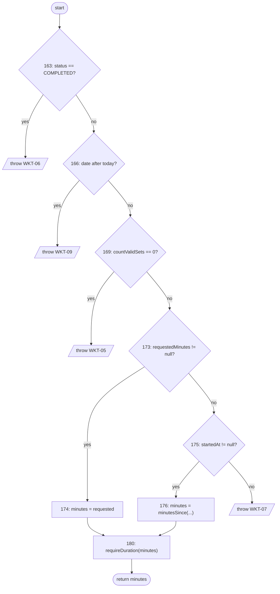
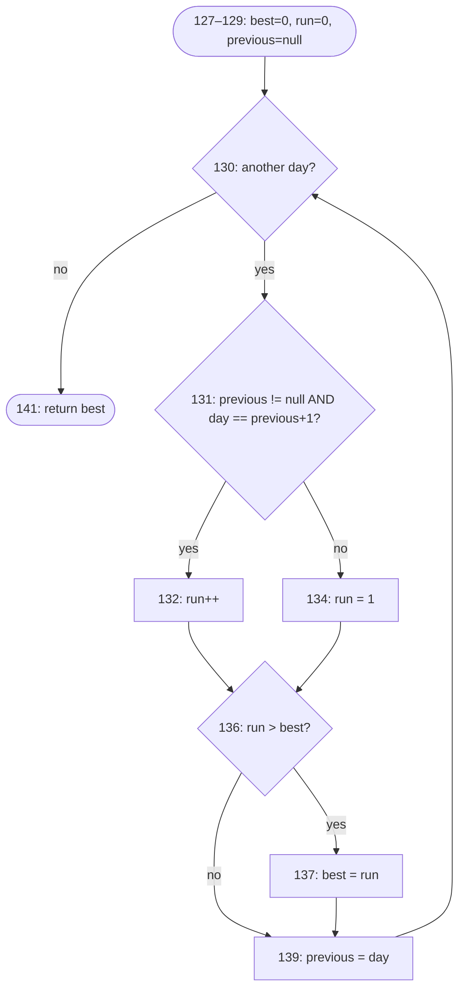

# Gym Tracker: Test Plan and Test Design

System Under Test: Gym Tracker 1.0 (this repository), requirements in [requirements.md](requirements.md),
requirement → test mapping in [traceability-matrix.md](traceability-matrix.md).

> **About the numbers in this document.** Section 9 records a real execution on 2026-11-19
> (`./mvnw clean test` and the PIT goal, run in `backend/`, after the frontend/backend restructure). Every number there was copied from the generated reports.
> If you change code or tests, re-run the commands and update section 9; do not edit the numbers by hand.

## 1. Scope

| In scope | Out of scope |
| --- | --- |
| Business rules in `service/` (services and `*Validator` classes, unit level) | Load/performance testing |
| REST API, controllers, error format (integration) | Penetration testing (only the basic security rules AUTH-05/08/11 are tested) |
| SQLite schema, seed data, constraints (service-to-database) | Automated browser (UI) tests; the UI was checked manually (section 8) |
| Full user journey through the API (system / end-to-end) | Any hosted or deployed environment (the app is localhost-only) |

## 2. Test environment

| Item | Version / value |
| --- | --- |
| OS used for the recorded run | macOS (Apple silicon) |
| JDK | Temurin 17.0.20 (project targets Java 17; the build also compiles on newer JDKs) |
| Build | Maven 3.9.9 via `./mvnw` (or a local `mvn`) |
| Framework | Spring Boot 3.5.16, JdbcTemplate, SQLite JDBC 3.49.1.0 |
| Test libraries | JUnit 5 (Jupiter, parameterized), Mockito, AssertJ, Spring MockMvc |
| Coverage / mutation | JaCoCo 0.8.16, PIT 1.30.2 + pitest-junit5-plugin 1.2.3 |
| Test database | `backend/target/gym-test.db` (profile `test`), emptied before every integration test; never the real `backend/data/` file |

## 3. Test levels and suites

| Level | Where | What it proves |
| --- | --- | --- |
| Unit | `backend/src/test/java/com/gymtracker/unit` (8 classes) | Each business rule in isolation. Pure static methods get hand-made data and a fixed date; services that read the database get Mockito mocks. |
| Integration: controller ↔ service | `integration/*IntegrationTest` via MockMvc | HTTP status, JSON body and rule code for each endpoint. |
| Integration: service ↔ database | `integration/DatabaseIntegrationTest` + every integration test | Seed data, idempotent schema, foreign keys, CHECK constraints, cascade deletes, data really persisted. |
| Integration: authentication ↔ workouts | `AuthIntegrationTest`, `WorkoutIntegrationTest.otherUserIsolation` | Token required, expired/logged-out tokens refused, users isolated. |
| Integration: workout logging → progress | `ProgressIntegrationTest`, `GoalIntegrationTest` | Numbers shown in progress and goals are calculated from what was logged. |
| System / end-to-end | `integration/EndToEndScenarioTest` (scenario SC-01) | One user's full journey in the same order as the website. |
| System (manual, through the website) | [system-test-plan.md](system-test-plan.md): phases 0–6, cases ST-01…ST-86, scenarios SC-01…SC-06 | The complete application as a user meets it, including restart, two users, browsers and phone screens. |
| Regression | the whole suite: `./mvnw test` in `backend/` | Re-run after every change; SC-01 is the smoke test. All 244 tests must pass. |

## 4. Black-box test design

### 4.1 Equivalence partitioning (EP)

| Input | Valid classes | Invalid classes | Tests |
| --- | --- | --- | --- |
| Repetitions (WKT-01) | V1: integer 1–100 | I1: < 1 · I2: > 100 · I3: missing · I4: decimal (5.5) | `WorkoutValidatorTest.repetitionBoundaries`, `WorkoutIntegrationTest.setBoundaries` |
| Weight kg (WKT-02) | V1: 0–500 | I1: < 0 · I2: > 500 · I3: missing · I4: NaN | `WorkoutValidatorTest.weightBoundaries`, `.weightNaN` |
| Sets per exercise (WKT-03) | V1: 1–20 | I1: < 1 · I2: > 20 · I3: missing · I4: 21st logged set | `WorkoutValidatorTest.setCountBoundaries`, `WorkoutServiceTest.setCountLimit` |
| Duration min (WKT-04) | V1: 1–300 | I1: < 1 · I2: > 300 · I3: missing on a never-started workout (WKT-07) | `WorkoutValidatorTest.durationBoundaries`, `WorkoutCompletionTest` |
| Username (AUTH-01) | V1: 3–30 allowed chars | I1: too short · I2: too long · I3: forbidden char (`-`, space, `@`, `é`) · I4: null/empty | `UserValidatorTest.Username` |
| Email (AUTH-02) | V1: name@domain.tld ≤ 100 | I1: no `@` · I2: no dot after `@` · I3: space · I4: > 100 · I5: null/empty | `UserValidatorTest.Email` |
| Password (AUTH-03) | V1: 8–64 with letter and digit | I1: < 8 · I2: > 64 · I3: no digit · I4: no letter · I5: neither · I6: null | `UserValidatorTest.Password` |
| Goal target (GOL-02/05) | V1: > 0 (count: whole; weight: ≤ 500) | I1: ≤ 0 · I2: missing · I3: count with decimals · I4: weight > 500 | `GoalRulesTest.Validation.targetValue` |
| Goal date (GOL-03) | V1: today or later · V2: unchanged past date on edit | I1: past on create · I2: changed to a past date · I3: missing | `GoalRulesTest.Validation.targetDateOnCreate/OnUpdate` |
| Exercise filter (EXR-02/03) | search: empty / matches name / matches description · group: none / valid | group: unknown (`wings`) | `ExerciseServiceTest.filterCombinations`, `.muscleGroup` |

### 4.2 Boundary value analysis (BVA)

For every numeric range the tests use min−1, min, min+1, a nominal value, max−1, max, max+1 (and "missing").

| Rule | Values tested | Expected valid |
| --- | --- | --- |
| WKT-01 reps | −1, **0**, **1**, 2, 50, 99, **100**, **101**, null | 1, 2, 50, 99, 100 |
| WKT-02 weight | −0.01, **0**, 0.01, 250, 499.99, **500**, **500.01**, −100, null | 0 … 500 |
| WKT-03 sets | **0**, **1**, 2, 10, 19, **20**, **21**, null; 19 → 20th set allowed, 20 → 21st refused | 1 … 20 |
| WKT-04 duration | −5, **0**, **1**, 2, 60, 299, **300**, **301**, null; measured 300 min vs 300 min + 1 s | 1 … 300 |
| AUTH-01 username length | 2, **3**, **30**, 31 | 3, 30 |
| AUTH-02 email length | **100**, **101** | 100 |
| AUTH-03 password length | 7, **8**, **64**, 65 | 8, 64 |
| AUTH-08 token age | 7 days − 1 s, **7 days**, 7 days + 1 s | only 7 days − 1 s |
| GOL-01 title | 0 (blank), 1, **80**, 81 | 1, 80 |
| GOL-03 date | yesterday, **today**, tomorrow | today, tomorrow |
| GOL-05 weight target | **500**, 500.01 | 500 |
| GOL-07 percent | 9.99/10 → 99, 10/10 → 100, 15/10 → 100 (cap) | – |
| PRG-04 week window | day −1, 0, 6, 7, 55, 56 of the 8-week window | 0 … 55 |

### 4.3 Cause–effect graphing

**CE-1: Completing a workout (WKT-04 … WKT-07, WKT-09)** in `WorkoutService.completionMinutes`

Causes: C1 status is COMPLETED · C2 workout date is after today · C3 at least one valid logged set · C4 a duration was entered · C5 the workout was started · C6 the resulting minutes are within 1–300.
Effects: E1 refuse WKT-06 · E2 refuse WKT-09 · E3 refuse WKT-05 · E4 refuse WKT-07 · E5 refuse WKT-04 · E6 complete.

```
E1 = C1
E2 = ¬C1 ∧ C2
E3 = ¬C1 ∧ ¬C2 ∧ ¬C3
E4 = ¬C1 ∧ ¬C2 ∧ C3 ∧ ¬C4 ∧ ¬C5
E5 = ¬C1 ∧ ¬C2 ∧ C3 ∧ (C4 ∨ C5) ∧ ¬C6
E6 = ¬C1 ∧ ¬C2 ∧ C3 ∧ (C4 ∨ C5) ∧ C6
Constraint: effects are mutually exclusive (exactly one fires).
```

**CE-2: Valid logged set (WKT-05)**: E "set counts" = C1 ticked ∧ C2 reps 1–100 ∧ C3 weight 0–500 (all 8 combinations in `WorkoutCompletionTest.validSetConditions`).

**CE-3: Goal target date (GOL-03)**: C1 date missing · C2 date differs from the stored one (a new goal has none, so it always differs) · C3 date before today. E1 refuse = C1 ∨ (C2 ∧ C3); otherwise accept. Tests: `GoalRulesTest.Validation.targetDateOnCreate`, `targetDateOnUpdate` (C2 × C3 all four combinations).

**CE-4: Password (AUTH-03)**: C1 length 8–64 · C2 contains a letter · C3 contains a digit. Accept = C1 ∧ C2 ∧ C3.

### 4.4 Decision tables

**DT-1: Workout completion** (from CE-1; tests in `WorkoutCompletionTest`)

| Rule | R1 | R2 | R3 | R4 | R5 | R6 | R7 | R8 |
| --- | --- | --- | --- | --- | --- | --- | --- | --- |
| C1 already COMPLETED | Y | N | N | N | N | N | N | N |
| C2 dated in the future | – | Y | N | N | N | N | N | N |
| C3 ≥ 1 valid set | – | – | N | Y | Y | Y | Y | Y |
| C4 duration entered | – | – | – | Y | Y | N | N | N |
| C5 started | – | – | – | – | – | Y | Y | N |
| C6 minutes 1–300 | – | – | – | Y | N | Y | N | – |
| **Result** | WKT-06 | WKT-09 | WKT-05 | complete (entered) | WKT-04 | complete (measured) | WKT-04 | WKT-07 |
| Test | `r1AlreadyCompleted` | `r2FutureDate` | `r3NoValidSet` | `r4r5RequestedMinutes` (1, 45, 300) | `r4r5…` (0, 301, −10) | `r6MeasuredFromStart` | `r7MeasuredTooLong` | `r8NeverStarted` |

**DT-2: Goal state (GOL-10)**; tests: `GoalRulesTest.state`

| Rule | 1 | 2 | 3 | 4 |
| --- | --- | --- | --- | --- |
| Status COMPLETED | Y | N | N | N |
| Percent = 100 | – | Y | N | N |
| Target date before today | – | – | Y | N |
| **State** | COMPLETED | ACHIEVED | OVERDUE | ACTIVE |

**DT-3: Mark goal completed (GOL-08)**: ACTIVE ∧ 100 % → completed; ACTIVE ∧ < 100 % → GOL-08; COMPLETED → GOL-08. Tests: `GoalRulesTest.WithMocks.completeTooEarly`, `completeAtTarget`, `GoalIntegrationTest.progressAndCompletion`.

**DT-4: Login (AUTH-06)**

| Username/password blank | User exists | Password matches | Result | Test |
| --- | --- | --- | --- | --- |
| Y | – | – | 400 AUTH-06 | `AuthServiceTest.loginBlankFields` |
| N | N | – | 401 AUTH-06 | `AuthServiceTest.loginFailures` |
| N | Y | N | 401 AUTH-06 (same message) | `AuthServiceTest.loginFailures`, `AuthIntegrationTest.login` |
| N | Y | Y | 200 + token | `AuthServiceTest.loginSuccess` |

## 5. White-box test design

V(G) = number of predicate (decision) nodes + 1, counting each simple condition of a `&&`/`||` as its own predicate. This is how the compiled code branches, and it matches what JaCoCo counts as branches.

### 5.1 `WorkoutService.completionMinutes` (WorkoutService.java lines 162–182)



Predicates 5 → **V(G) = 6**. Basis paths:

| Path | Route | Test |
| --- | --- | --- |
| P1 | B yes | `r1AlreadyCompleted` |
| P2 | B no, C yes | `r2FutureDate` |
| P3 | B, C no, D yes | `r3NoValidSet` |
| P4 | B, C, D no, E yes → I → J | `r4r5RequestedMinutes` (valid values) |
| P5 | B, C, D, E no, G yes → I → J | `r6MeasuredFromStart` |
| P6 | B, C, D, E no, G no | `r8NeverStarted` |

(The WKT-04 exits inside `requireDuration` belong to `WorkoutValidator.requireDuration`, a separate method with its own V(G) = 4, tested by `durationBoundaries`.)

### 5.2 `UserValidator.password` (UserValidator.java lines 45–61)

Predicates: line 46 `raw == null`, `length < 8`, `length > 64` (3) · line 51 loop (1) · line 52 `isLetter` (1) · line 54 `isDigit` (1) · line 58 `!hasLetter`, `!hasDigit` (2) = 8 → **V(G) = 9**.

Multiple condition coverage of line 58 (valid length): (letter, digit) = TT `abcdefg1` accept · TF `abcdefgh` reject · FT `12345678` reject · FF `!!!!!!!!` reject. Line 46: null, 7 chars, 65 chars each make the `||` true by a different operand; 8 and 64 make it false. The loop runs 0 times only for an empty string, which line 46 already rejects, so "zero iterations" is infeasible here; it runs 8 and 64 times in the tests. Mutation testing showed one more case was needed: `abcdefg!` (a symbol must not count as a digit; see 5.7).

### 5.3 `ProgressService.longestStreak` (ProgressService.java lines 126–142)



Predicates: loop (1), line 131 (2), line 136 (1) = 4 → **V(G) = 5**.

Basis paths: P1 empty list (loop 0 times) · P2 one day (131 false via `previous == null`, 136 true) · P3 consecutive day that beats the best (131 true, 136 true) · P4 gap after a run (131 false via the date test, 136 false) · P5 consecutive day that does not beat the best (131 true, 136 false). All are in `ProgressServiceTest.Streaks.longestStreak` (inputs `[]`, `[today]`, `[1,2,3,5,6 Nov]`).

**LCSAJ coverage.** An LCSAJ is (start line, end line, jump target). Jump targets here are 130 (loop back), 134, 136, 139, 141.

| # | Start | End | Jump to | Feasible | Exercised by input |
| --- | --- | --- | --- | --- | --- |
| 1 | 127 | 130 | 141 | yes | `[]` |
| 2 | 127 | 131 | 134 | yes | any non-empty list (first day) |
| 3 | 127 | 132 | 136 | **no**: on the first day `previous` is null | – |
| 4 | 130 | 130 | 141 | yes | end of any non-empty list |
| 5 | 130 | 131 | 134 | yes | 5 Nov after 3 Nov (gap) |
| 6 | 130 | 132 | 136 | yes | 2 Nov after 1 Nov |
| 7 | 134 | 136 | 139 | yes | 5 Nov (run 1 ≤ best 3) |
| 8 | 134 | 140 | 130 | yes | first day (run 1 > best 0) |
| 9 | 136 | 136 | 139 | yes | 6 Nov (run 2 ≤ best 3) |
| 10 | 136 | 140 | 130 | yes | 2 Nov, 3 Nov (run beats best) |
| 11 | 139 | 140 | 130 | yes | after 7 or 9 |
| 12 | 141 | 141 | exit | yes | every call |

11 of 11 feasible LCSAJs are exercised by the three inputs above (#3 is infeasible).

**Data flow (def-use pairs).**

| Variable | Definitions | Uses | DU pairs and coverage |
| --- | --- | --- | --- |
| `best` | d1 line 127, d2 line 137 | p-use 136, c-use 141 | (d1,136) first day · (d1,141) empty list · (d2,136) second day · (d2,141) any non-empty list. All covered. |
| `run` | d1 128, d2 132, d3 134 | p-use 136, c-use 137, c-use 132 (`run++` reads it) | (d1, any use) **infeasible**: `run` is always redefined at 132/134 before it is read, so d1 is a dead definition (PIT mutant "0 → 1" on line 128 survives for this reason; see 5.7). (d2,136), (d2,137), (d3,136), (d3,137), (d3,132), (d2,132) covered by `[1,2,3,5,6 Nov]`. |
| `previous` | d1 129, d2 139 | p-use 131 (`!= null`), c-use 131 (`plusDays`) | (d1, p-use 131) first day · (d2, p-use 131) and (d2, c-use 131) every later day. Covered. |

### 5.4 `WorkoutService.countValidSets`

`for` (1) + `completed` (1) + `isValidReps` (1) + `isValidWeight` (1) → **V(G) = 5**. Loop tested with 0, 1 and 3 iterations (`countValidSetsLoop`); the compound condition with all 8 combinations (`validSetConditions`, multiple condition coverage).

### 5.5 `GoalValidator.targetDate` and `GoalService.state`

`targetDate`: `date == null` (1) + `isNewOrChanged && isBefore` (2) → **V(G) = 4**; MCC of the second decision in `targetDateOnUpdate`.
`state`: three `if`s → **V(G) = 4**; one test per path in `GoalRulesTest.state` (DT-2).

### 5.6 Statement, decision and condition coverage (measured by JaCoCo)

JaCoCo's **line** counter is statement coverage and its **branch** counter covers both outcomes of every simple condition (decision and condition coverage at bytecode level). The goal for the `service` package (where all rules live) is 100 % of both; section 9 shows the measured result. Multiple condition coverage is not measured by any tool: it is designed by hand in the MCC tests listed in 5.2, 5.4 and 5.5.

### 5.7 Mutation testing (PIT)

Configuration (`backend/pom.xml`): target classes `com.gymtracker.service.*` (services, validators and `ApiException`); tests `com.gymtracker.unit.*` (the fast unit tests only, so integration-only code shows as NO_COVERAGE); mutators `DEFAULTS` (conditionals boundary, negate conditionals, math, increments, invert negatives, return values, void method calls), `REMOVE_CONDITIONALS`, `INLINE_CONSTS`.

Mutation score = killed ÷ generated. Test strength = killed ÷ (generated − no coverage).

**How the first PIT run improved the tests (recorded on 2026-11-19):**

| Run | Generated | Killed | Survived | No coverage | Score | Test strength |
| --- | --- | --- | --- | --- | --- | --- |
| 1st (before analysis) | 653 | 582 | 42 | 29 | 89.1 % | 93.3 % |
| After the fixes | 651 | 622 | 9 | 20 | 95.5 % | 99 % |
| Final (after moving validators and `ApiException` into `service`) | 657 | 628 | 9 | 20 | 95.6 % | 99 % |

What the surviving mutants of the first run revealed, and what was done:

| Finding | Action |
| --- | --- |
| `UserValidator.password`: "is a digit" → "always true" survived; no test had letters + a symbol but no digit. | Test `symbolIsNotADigit` (`abcdefg!`, `pass word`). |
| `GoalValidator.targetDate`: the `previous == null ||` part could be removed without any test noticing, because `date.equals(null)` is already false. A **redundant condition**. | Condition removed from the code (fewer paths, same behaviour). |
| `GoalService.currentValue`: "keep the heaviest" → "keep the last" survived because the heaviest set was also the last one in the data. | Added a lighter set after the heaviest. |
| `AuthService.issueToken`: deleting `SecureRandom.nextBytes` (every token identical) survived. Security relevant. | Test `tokensAreRandom` (43 URL-safe chars, two logins differ). |
| WorkoutService filters by exercise block survived because the mocks had a single block. | Tests `setsPerBlock`, `completedWorkoutWithTwoBlocks`. |
| `null` request fields (`planSlug`, `completed`, `currentPassword`, complete without body) were never sent in unit tests. | Added null cases. |

**Remaining 9 survivors (final run) and their analysis:**

| Mutant | Category | Reason |
| --- | --- | --- |
| `ProgressService.longestStreak:128` 0 → 1 | Equivalent | `run` is always reassigned before it is read (dead definition, 5.3). |
| `ProgressService.longestStreak:136` `>` → `>=` | Equivalent | When `run == best`, `best = run` changes nothing. |
| `GoalService.currentValue:136` `>` → `>=` | Equivalent | Same: replacing the max with an equal value. |
| `ProgressService.exerciseProgression:213` array size 3 → 4 | Equivalent | The extra slot is never used. |
| `WorkoutService.minutesSince:188` `Integer.MAX_VALUE` → +1 | Equivalent in practice | Only matters for a workout started 4 000+ years ago; WKT-04 rejects anything over 300 anyway. |
| `ExerciseService.filter:38` `term.isEmpty()` removed | Equivalent | `name.contains("")` is always true. Kept on purpose for readability (contrast with the `GoalValidator` case, where the redundant condition was removed). |
| `AuthService.tokenFrom:138` (2 mutants) | Equivalent at unit level | Without the length check `"Bearer "` gives an empty token, which is not in the database, so it is still 401 AUTH-08. |
| `WorkoutService.logSet:265` (`completed` default) | Open | Killing tests exist for both `completed = null` and `false`. Why PIT still reports this one has not been analysed yet: a task for the team. |

The 20 NO_COVERAGE mutants are in methods that only read or write the database (`list`, `delete`, `updateProfile`, `logout`, `summary`, …). PIT runs only unit tests, so it cannot see the integration tests that execute these lines. JaCoCo, which runs the whole suite, reports 100 % line coverage for the `service` package.

## 6. Integration and system test cases

| ID | Test (class.method) | Interface covered |
| --- | --- | --- |
| IT-01 | `DatabaseIntegrationTest.seedMatchesOriginalWebsite` | schema.sql → SQLite (27 exercises, 5 days, 37 entries) |
| IT-02 | `DatabaseIntegrationTest.schemaIsIdempotent` | restart safety: re-running the schema keeps data |
| IT-03 | `DatabaseIntegrationTest.foreignKeysOn`, `.checkConstraints` | FK and CHECK constraints in the database |
| IT-04 | `AuthIntegrationTest.*` (7) | register/login/logout/profile through HTTP and DB |
| IT-05 | `WorkoutIntegrationTest.*` (11) | workout API ↔ WorkoutService ↔ DB, cascades, isolation, request errors |
| IT-06 | `ExerciseIntegrationTest.*` (2) | library search/filter/custom through HTTP |
| IT-07 | `ProgressIntegrationTest.*` (4) | logged sets → progress, history, exercise chart data, dashboard |
| IT-08 | `GoalIntegrationTest.*` (3) | stored workouts → goal progress, completion, isolation |
| SC-01 | `EndToEndScenarioTest.fullJourney` | register → goal → Push Day → 3 sets (1 un-ticked) → progress unchanged → complete → progress/streak/week → goal completed → logout → login → data still there |
| SC-02 | `EndToEndScenarioTest.staticSite` | the website files are served by the same application |

## 7. Entry and exit criteria

Entry: the project compiles (`./mvnw test-compile` in `backend/`); requirements in `requirements.md` are baselined.
Exit: all tests pass; JaCoCo branch coverage of `service` is 100 %; every surviving PIT mutant is either killed or explained in 5.7; no open defect of high severity.

## 8. Manual UI checks (recorded 2026-11-19, built-in browser, 1024 px and 375 px)

Re-checked after the restructure into `frontend/` (one HTML page per screen): guest vs. member links and buttons · register → dashboard · Plan → Start Push Day → 7 exercises · log 30 kg × 8 (auto-start, 240 kg, next set pre-filled) · 101 reps → "(WKT-01)" · complete with 301 → "(WKT-04)", 45 → Completed · edit name and notes · un-tick the only set → "(WKT-12)", tick restored · history filter "Completed" · exercise search "curl" 5, + Biceps 4, custom exercise added · progress totals, 3 charts, history · weight goal: past date → "(GOL-03)", 30 kg reached, marked completed · profile saved · logout, then dashboard.html redirects to login.html · no horizontal scrolling on any of the 9 pages at 375 px.

First round (single-page version, before the restructure):

Logged-out landing page with the original plan · registration with a too-short password shows "… (AUTH-03)" · registration → dashboard (Thursday shown as recovery day) · Plan → "Start Push Day" opens a session with 7 exercises · logging 30 kg × 8 auto-starts the workout and shows 240 kg · 101 reps shows "(WKT-01)" · Complete dialog with 301 min shows "(WKT-04)", 45 min completes · un-ticking the only set of a completed workout shows "(WKT-12)" and restores the tick · Progress page charts and history · weight goal 30 kg reaches 100 % and can be marked completed · exercise search "row" finds 3 · no horizontal scrolling at 375 px · no JavaScript errors in the console (the four HTTP 400s in the console were the deliberate invalid inputs above).

Defects found and fixed during these checks and the first runs:

| # | Defect | Fix |
| --- | --- | --- |
| D1 | Unsupported content type (415) was returned as 500 by the catch-all error handler. | Spring's own errors keep their status (REQ-00); test `WorkoutIntegrationTest.requestErrors`. |
| D2 | A query inside a row mapper would need a second connection, but the pool has one (SQLite), so it could deadlock. | Plan days and their exercises are read one after the other. |
| D3 | The goal form showed the exercise picker although it was `hidden` (CSS `display:grid` won over `[hidden]`). | Global `[hidden]{display:none !important}`. |
| D5 | (found while restructuring, before release) `form.name` / `form.title` return the form's own properties, not the inputs called "name"/"title", so the edit dialogs would have been empty. | All pages read inputs with `form.elements.x`. |
| D4 | On phones the set row squeezed the "done" tick into the 44 px column. | Two-line set row under 680 px. |

## 9. Execution record (2026-11-19)

Commands (Temurin 17, from the `backend/` folder):

```bash
cd backend
./mvnw clean test
./mvnw test-compile org.pitest:pitest-maven:mutationCoverage
```

**Tests:** 244 run, 0 failures, 0 errors, 0 skipped (`BUILD SUCCESS`).

| Suite | Class | Tests |
| --- | --- | --- |
| unit | UserValidatorTest | 30 |
| unit | AuthServiceTest | 12 |
| unit | WorkoutValidatorTest | 38 |
| unit | WorkoutCompletionTest | 31 |
| unit | WorkoutServiceTest | 16 |
| unit | ProgressServiceTest | 27 |
| unit | GoalRulesTest | 41 |
| unit | ExerciseServiceTest | 16 |
| integration | AuthIntegrationTest | 7 |
| integration | WorkoutIntegrationTest | 11 |
| integration | ExerciseIntegrationTest | 2 |
| integration | ProgressIntegrationTest | 4 |
| integration | GoalIntegrationTest | 3 |
| integration | DatabaseIntegrationTest | 4 |
| system | EndToEndScenarioTest | 2 |
| | **Total** | **244** |

**JaCoCo** (`backend/target/site/jacoco/index.html`, whole suite; `GymTrackerApplication` excluded):

| Package | Instructions | Branches | Lines |
| --- | --- | --- | --- |
| controller | 91.7 % (400/436) | 33.3 % (2/6) | 94.5 % (86/91) |
| model | 100 % (784/784) | 100 % (2/2) | 100 % (46/46) |
| repository | 96.3 % (1129/1172) | 75.0 % (21/28) | 95.8 % (137/143) |
| service | 99.7 % (2831/2840) | **100 % (385/385)** | **100 % (524/524)** |
| **Total** | **98.3 % (5144/5232)** | **97.4 % (410/421)** | **98.6 % (793/804)** |

**PIT** (`backend/target/pit-reports/index.html`):

| Class | Generated | Killed | Survived | No coverage | Score |
| --- | --- | --- | --- | --- | --- |
| ApiException | 6 | 6 | 0 | 0 | 100 % |
| AuthService | 59 | 48 | 2 | 9 | 81 % |
| ExerciseService | 33 | 30 | 1 | 2 | 91 % |
| ExerciseValidator | 27 | 27 | 0 | 0 | 100 % |
| GoalService | 73 | 71 | 1 | 1 | 97 % |
| GoalValidator | 40 | 40 | 0 | 0 | 100 % |
| ProgressService | 123 | 116 | 3 | 4 | 94 % |
| UserValidator | 54 | 54 | 0 | 0 | 100 % |
| WorkoutService | 159 | 153 | 2 | 4 | 96 % |
| WorkoutValidator | 83 | 83 | 0 | 0 | 100 % |
| **Total** | **657** | **628** (1 of them timed out) | **9** | **20** | **95.6 %** |

PIT's own summary line: "Generated 657 mutations Killed 628 (96%) · Mutations with no coverage 20 · Test strength 99%".
